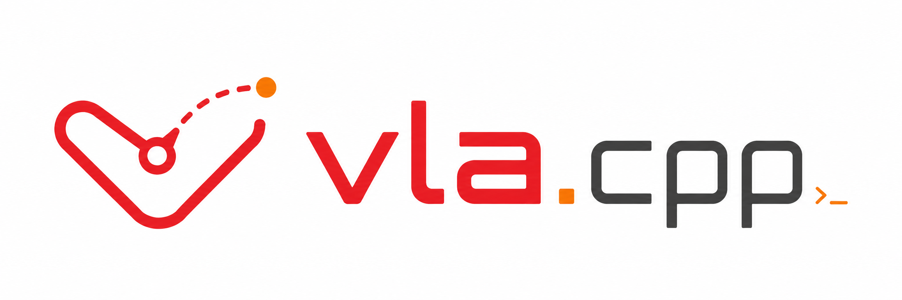

# vla.cpp



[](LICENSE.md)
[](https://github.com/ggml-org/llama.cpp)
[](https://huggingface.co/vrfai)
[](http://arxiv.org/abs/2606.08094)

A C++ inference engine for **Vision-Language-Action (VLA) models**, built on [`llama.cpp`](https://github.com/ggml-org/llama.cpp).
It runs the open VLA policies under one runtime, each packaged as a single self-contained GGUF that needs no Python or
PyTorch at inference time. The binaries drive robots on **CPU**, **Apple Silicon**,
**NVIDIA** (including Jetson), **AMD**, **Intel** and **Qualcomm** hardware.

---

## Install

Download a prebuilt release, or build from source for any other platform or
backend.

### Prebuilt binaries

Each [release](https://github.com/VinRobotics/vla.cpp/releases) ships tarballs
for Linux x86-64 and aarch64 (CPU and CUDA) and macOS arm64 (Metal):

```bash
TAG=<release tag>
curl -LO https://github.com/VinRobotics/vla.cpp/releases/download/$TAG/vla.cpp-$TAG-linux-x86_64-cpu.tar.gz
tar -xzf vla.cpp-$TAG-linux-x86_64-cpu.tar.gz
```

Each platform's requirements are in [docs/PREBUILT.md](docs/PREBUILT.md).

### Build from source

The CPU build needs CMake ≥ 3.22, a C++17 compiler (GCC 11+ or Clang 14+),
ZeroMQ and protobuf. CMake fetches and pins `llama.cpp` itself:

```bash
sudo apt-get install -y libzmq3-dev cppzmq-dev libprotobuf-dev protobuf-compiler
cmake -B build -DCMAKE_BUILD_TYPE=Release
cmake --build build -j$(nproc)
```

`-DVLA_BUILD_SERVER=OFF -DVLA_SPM=OFF` drops the apt packages and builds only
`vla-cli`, `vla-bench` and `libvla`; Octo then takes `--tokens` instead of `--text`.

For a GPU or NPU, follow the backend's page in [docs/backend/](docs/backend):
[CUDA](docs/backend/cuda.md), [ROCm](docs/backend/rocm.md),
[SYCL](docs/backend/sycl.md), [OpenVINO](docs/backend/ov.md),
[Metal](docs/backend/metal.md), [Hexagon](docs/backend/hexagon-windows.md).
For containers, see [docs/DOCKER.md](docs/DOCKER.md).

---

## Quickstart

Once the binaries are built, run one CPU prediction without a server or simulator:

```bash
pip install -U "huggingface_hub[cli]" transformers

# -hf fetches and caches the checkpoint (under $VLA_CACHE, default ~/.cache/vla)
./build/vla-cli -hf vrfai/smolvla-libero-gguf \
    --image assets/front.jpg --text "pick up the black bowl" --pretty

# or point at a file you already have
./build/vla-cli --ckpt models/smolvla/smolvla-libero.gguf \
    --image assets/front.jpg --text "pick up the black bowl" --pretty
```

With a prebuilt tarball, run `vla-cli` from the extracted
`vla.cpp-<tag>-<platform>/` directory instead of `./build/`.
`--pretty` prints one action row per line and `--state` sets proprioception.
Prompt tokenization, `-hf` tags, `vla-server`, runtime flags and environment
variables are in [docs/USAGE.md](docs/USAGE.md).

---

## Support matrix

Models (rows) against platforms (columns).
Per-device latency and memory are in [docs/benchmark/](docs/benchmark).
Use [ggml-compiler](https://github.com/khanhnd61-vr/ggml-compiler) and follow [the instruction](docs/ARCHITECTURE.md#adding-an-architecture) to add a new model.


| Model | CPU (x86-64 / ARM) | [CUDA (NVIDIA)](docs/backend/cuda.md) | [ROCm (AMD)](docs/backend/rocm.md) | [SYCL (Intel)](docs/backend/sycl.md) | [Metal (Apple)](docs/backend/metal.md) | [OpenVINO (Intel)](docs/backend/ov.md) | [Hexagon (Qualcomm)](docs/backend/hexagon-windows.md) |
|---|:--:|:--:|:--:|:--:|:--:|:--:|:--:|
| [SmolVLA](https://hf.co/vrfai/smolvla-libero-gguf)             | Y | Y | Y | Y | Y | Y | Y |
| [π0](https://hf.co/vrfai/pi0-libero-finetuned-v044-gguf)       | Y | Y | Y | Y | Y | Y | ~ |
| [π0.5](https://hf.co/vrfai/pi05-libero-gguf)                   | Y | Y | Y | Y | Y | Y | Y |
| [GR00T N1.5](https://hf.co/vrfai/gr00tn1d5-libero-object-gguf) | Y | Y | Y | Y | Y | Y | Y |
| [GR00T N1.6](https://hf.co/vrfai/gr00tn1d6-libero-gguf)        | Y | Y | Y | Y | Y | Y | Y |
| [GR00T N1.7](https://hf.co/vrfai/gr00tn1d7-libero-gguf)        | Y | Y | Y | Y | Y | Y | Y |
| [BitVLA](https://hf.co/vrfai/bitvla-libero-gguf)               | Y | Y | - | - | - | - | - |
| [Evo-1](https://hf.co/vrfai/evo1-libero-gguf)                  | Y | Y | Y | Y | Y | Y | Y |
| [VLA-Adapter](https://hf.co/vrfai/vla-adapter-libero-gguf)     | Y | Y | Y | Y | Y | Y | Y |
| [OpenVLA-OFT](https://hf.co/vrfai/openvla-oft-libero-gguf)     | Y | Y | Y | - | Y | Y | - |
| [VLA-JEPA](https://hf.co/vrfai/vla-jepa-libero)                | Y | Y | Y | Y | Y | Y | ~ |
| [Octo-Small](https://hf.co/vrfai/octo-small-libero-gguf)       | Y | Y | Y | Y | Y | - | Y |
| [TurboVLA](https://hf.co/vrfai/turbovla-libero-gguf)           | Y | Y | Y | Y | Y | Y | Y |
| [ACT](https://hf.co/ravediamond/act-aloha-sim-transfer-cube-gguf) | Y | Y | Y | ~ | Y | ~ | ~ |

Legend: `Y` = supported (released and benchmarked), `~` = in progress, `-` = planned.

---

## Rollout on a real robot

The [LeRobot fork](https://github.com/khanhnd61-vr/lerobot/tree/vla-simd) adds a
`lerobot-vla-cpp` client that drives an SO-101 arm against `vla-server`. It does
the preprocessing for SmolVLA, π0, π0.5 and GR00T N1.5/1.6/1.7. Serve the policy
on a GPU host; on a desktop CPU the action queue stalls:

```bash
./build/vla-server smolvla-so101.gguf   # binds tcp://*:5555
```

Installing, wiring and running the client are in the fork's
[rollout guide](https://github.com/khanhnd61-vr/lerobot/tree/vla-simd#through-a-vlacpp-server).

---

## Companion Repos

| Repo | Content |
|---|---|
| [llama.cpp](https://github.com/ggml-org/llama.cpp) | ggml and its backends; CMake fetches it at a pinned tag (`b11223`) |
| [LeRobot fork](https://github.com/khanhnd61-vr/lerobot/tree/vla-simd) | `lerobot-vla-cpp`, the client that runs a real robot against `vla-server` |
| [ggml-compiler](https://github.com/khanhnd61-vr/ggml-compiler) | Generates ggml C++ from a policy's PyTorch implementation and verifies it, for porting a new model to `vla.cpp` |
| [Learn vla.cpp](https://fai-modelopt-tech.github.io/learn-vla-cpp/) | Walkthrough of the engine design and how each policy is implemented on ggml |

---

## Documentation

| Doc | Content |
|---|---|
| [docs/PREBUILT.md](docs/PREBUILT.md) | Release tarballs: layout, glibc and CUDA runtime requirements, macOS and Windows notes |
| [docs/USAGE.md](docs/USAGE.md) | `vla-cli`, `vla-server`, `vla-bench`: prompt tokenization, `-hf` tags, runtime flags, environment variables |
| [docs/EVAL.md](docs/EVAL.md) | Installing LIBERO and SimplerEnv, running the eval clients against `vla-server` |
| [docs/MODELS.md](docs/MODELS.md) | Converting safetensors checkpoints to GGUF, quantizing to Q8_0/Q4_0 |
| [docs/QUANTIZATION.md](docs/QUANTIZATION.md) | FoldQuant W8A8 / W4A4: the GGUF contract, the integer arithmetic, converting a FoldQuantVLA quantized model |
| [docs/DOCKER.md](docs/DOCKER.md) | Building and running the eval in containers |
| [docs/ARCHITECTURE.md](docs/ARCHITECTURE.md) | Engine design: layers, the prediction path, backends, adding an architecture |
| [docs/backend/](docs/backend) | Per-backend build and run notes: [CUDA](docs/backend/cuda.md), [ROCm](docs/backend/rocm.md), [SYCL](docs/backend/sycl.md), [OpenVINO](docs/backend/ov.md), [Metal](docs/backend/metal.md), [Hexagon](docs/backend/hexagon.md), [Hexagon on Windows](docs/backend/hexagon-windows.md), [WSL2](docs/backend/wsl.md) |
| [docs/benchmark/](docs/benchmark) | Per-device latency and memory for every model, and the fastest flags per device |
| [docs/KNOWN_ISSUES.md](docs/KNOWN_ISSUES.md) | Known issues and their resolutions |
| [docs/ADOPTION.md](docs/ADOPTION.md) | C ABI, Python bindings, release packaging, and what is left |
| [docs/UPSTREAMING.md](docs/UPSTREAMING.md) | The ggml-openvino fixes to send upstream to llama.cpp |
| [CHANGELOG.md](CHANGELOG.md) | Per-release changes, with the fastest configuration and success rate per model |
| [CONTRIBUTING.md](CONTRIBUTING.md) | Proving a change is numerically neutral, adding an architecture |
| [bindings/python/](bindings/python/README.md) | Python bindings |

---

## Citation

```bibtex
@misc{nguyen2026vlacpp,
  title         = {{vla.cpp}: A Unified Inference Runtime for Vision-Language-Action Models},
  author        = {Khanh D. Nguyen and Hung T. Ho and Chinh T. Nguyen and
                   Thanh Q. Duong and Linh D. Le and Duy M. H. Nguyen and
                   Vien A. Ngo and An T. Le},
  year          = {2026},
  eprint        = {2606.08094},
  archivePrefix = {arXiv},
  primaryClass  = {cs.RO},
  doi           = {10.48550/arXiv.2606.08094},
  url           = {https://arxiv.org/abs/2606.08094}
}
```

---

## License

Licensed under the [Apache License, Version 2.0](LICENSE.md).

---

## Acknowledgements

Supported VLA models:

- [ACT](https://arxiv.org/abs/2304.13705) - Zhao et al.
- [SmolVLA](https://huggingface.co/lerobot/smolvla_base) - Hugging Face LeRobot team.
- [π0,π0.5](https://github.com/Physical-Intelligence/openpi) - Physical Intelligence.
- [BitVLA](https://github.com/ustcwhy/BitVLA) - Hongyu Wang et al.
- [Evo-1](https://github.com/MINT-SJTU/Evo-1/tree/main) - Tao Lin et al.
- [VLA-Adapter](https://github.com/OpenHelix-Team/VLA-Adapter) - Yihao Wang et al.
- [OpenVLA-OFT](https://github.com/moojink/openvla-oft) - Moo Jin Kim et al.
- [GR00T N1.x](https://github.com/NVIDIA/Isaac-GR00T) - NVIDIA Isaac.
- [VLA-JEPA](https://github.com/ginwind/VLA-JEPA) - Jingwen Sun et al.
- [Octo](https://github.com/octo-models/octo) - Octo Model Team, UC Berkeley RAIL.
- [TurboVLA](https://github.com/H-EmbodVis/TurboVLA) - Hengyi Xie et al.

Built on:

- [`llama.cpp`](https://github.com/ggml-org/llama.cpp) - LLM inference engine in C/C++.
- [LIBERO](https://github.com/Lifelong-Robot-Learning/LIBERO) - benchmark suite for the success-rate sweeps.
- [SimplerEnv](https://github.com/simpler-env/SimplerEnv) - the second simulator in the eval scaffold.
