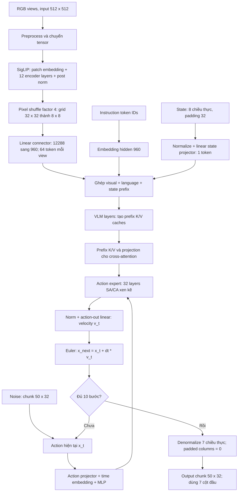

# SmolVLA: kiến trúc và giới hạn profiling

Cập nhật 05/11/2026; số đo gốc ngày 04/11/2026. Tài liệu kiến trúc từ paper và source, đã bổ sung kết quả trace ở cuối. Các đoạn kế hoạch được giữ làm giải thích phương pháp; số liệu hiện tại ở mục Kết quả profiling.

## Paper và checkpoint đang dùng

Paper mô tả VLM xử lý ảnh, instruction và state; action expert sinh action chunk bằng flow matching, kết hợp cross-attention và self-attention. Paper cũng dùng giảm visual token và bỏ bớt tầng để giảm tính toán. Đây là mô tả thiết kế; số tầng/chiều cụ thể phải lấy từ checkpoint đang đo. [SmolVLA, mục 3.1](https://arxiv.org/html/2506.01844v1#S3.SS1).

GGUF thực tế có 791 tensor; metadata đọc bằng script inspect_smolvla_metadata.py và lưu smolvla-metadata.json:

| Module | Cấu hình checkpoint |
|---|---|
| Vision | SigLIP, 12 tầng; hidden768, FFN3072, 12 head; input512, patch16 |
| Connector | Pixel shuffle factor4; 64 token/ảnh; projection sang hidden960 |
| VLM | 32 tầng; hidden960, FFN2560; query heads15, KV heads5, head_dim64 |
| Action expert | 32 tầng được source dựng theo cfg.n_layers; hidden480, FFN1280 |
| Attention expert | self_attn_every_n_layers=2: source chọn SA ở index chẵn, CA ở index lẻ |
| State / action | real state8, padded state32; chunk50, real action7, padded action32 |
| Solver | 10 bước, dt=-1/10; tokenizer_max_length48 |

Không thay số tầng32 hoặc expert width0.5 trong checkpoint bằng thông số minh họa của paper. Không khẳng định checkpoint này đã áp dụng đúng cấu hình layer skipping của paper.

## Luồng thực thi theo src/models/smolvla.cpp

Đây là sơ đồ luồng tính toán, không phải phép đo thời gian từng node. Connector là linear sau pixel shuffle, không tự coi là một transformer riêng. Caches được tái dùng giữa các bước denoise; không chạy lại toàn bộ vision/VLM mỗi bước.

| Source anchor | Vai trò |
|---|---|
| SmolVLAModelArch, khoảng dòng240 | Defaults vision, buffers, model state |
| Loader, khoảng dòng945 | Vision weights và connector mm_fc |
| expert_self_attn, khoảng dòng233 | Quy tắc chọn SA/CA |
| build_graph, khoảng dòng1205–1298 | VLM prefix K/V, cross-KV projection, vòng expert và Euler |
| predict_impl, khoảng dòng1307 | Preprocess, graph allocation, input/noise, execution và denormalization |

## Timing phase thật sự đo gì?

Đọc source khoảng dòng1350–1575; đây là giải thích phạm vi phép đo:

| Chỉ số | Phạm vi / giới hạn |
|---|---|
| ms_vision | Bao gồm phần xử lý vision trong predict: preprocess, tensor transfer, vision graph và connector, đọc embedding về host; chạy các view theo vòng lặp. Không phải pure GPU kernel time của riêng ViT. |
| ms_prefill | Khi bật PHASE: graph compute cần tạo prefix K/V caches. Không phải đồng hồ bao toàn bộ CPU graph construction, mọi copy hoặc một VLM standalone bất kỳ. |
| ms_denoise | Graph còn lại để sinh action: gồm phần expert/solver và các dependency như cross-KV reprojection. Không phải thời gian một bước hoặc riêng GEMM action expert. |
| ms_inference | ms_prefill + thời gian graph inference/denoise; ở default chưa bật phase, prefill không tách riêng. |
| ms_total | Wall-clock predict_impl, có nhiều overhead ngoài tổng các phase. |

PHASE dựng graph khác default: tách prefill, copy caches sang KV leaves, rồi chạy graph denoise. Copy K/V giữa hai đoạn không tự nằm trong hai đồng hồ compute. Phase dùng in.n_lang, còn default dùng cfg.n_lang (48 trong checkpoint này), nên input16token có topology/padding khác. Không lấy số phase rồi gọi đó là phân rã chính xác của baseline111,8ms nếu chưa kiểm tra khác biệt.

Chưa tách connector khỏi vision. Nếu cần số riêng vision/connector/VLM/action expert, phải thêm timing/instrumentation thích hợp, giữ default path làm đối chứng, và công bố overhead cùng thay đổi graph.

## Kế hoạch trace nsys

Sau khi LIBERO kết thúc, chạy workload engine riêng cho bản gốc và cấu hình tốt nhất đã được xác nhận; giữ cùng views/resolution/tokens/warmup/reps. Không chạy nsys cùng simulator để suy ra engine baseline. CUDA memory tracing trước đây chưa phải phân tích bottleneck kernel.

Đọc CUDA API/kernel timeline và kernel summary: phân loại GEMM, attention/norm/activation, copy, phần chưa phân loại; kiểm tra khoảng trống GPU và tương quan CPU launch/synchronization. Không chỉ cộng tổng duration kernel để suy ra wall-clock hoặc tỷ lệ idle khi có overlap. Phân tích kernel-name có ở mục kết quả, chưa phân loại toàn bộ attention theo ngữ nghĩa module.

Giới hạn quan sát tại máy: NVML process VRAM N/A; CPU sampling/context-switch tracing chưa được dùng; memory trace có diagnostic không trace được Unified Memory do peer-to-peer capability. Mọi giới hạn profiling khác trên WSL2 phải được xác minh từ log/tool docs trước khi khẳng định; không suy diễn là không trace được CUDA vì máy đã tạo được CUDA traces.

## Pruning: đọc CLP để chọn phương pháp

CLP dùng CKA của hidden states để chọn các tầng gần nhau có biểu diễn tương tự, rồi loại tầng theo cấu trúc. Paper có bước fine-tuning sau pruning; không được chuyển kết quả của paper thành lời hứa rằng bỏ tầng SmolVLA GGUF sẽ giữ SR mà không train. [CLP, mục 4](https://arxiv.org/html/2606.20246v1#S4).

Các hướng đã thử bằng depth ablation: (1) depth ablation có cấu trúc ở vision; (2) depth ablation có cấu trúc ở VLM/action expert, bảo toàn mapping K/V và loại SA/CA. Nếu chọn CKA-guided, cần calibration data/hidden states thật, không gọi random layer dropping là CLP. Không chọn tầng trên chính tập evaluation rồi báo SR như một kiểm tra độc lập. Zero weights đơn thuần chưa làm dense GEMM nhỏ đi.

Mỗi biến thể cần sửa graph/định dạng phù hợp, kiểm tra shape/output, đo latency module thật, smoke riêng; sau đó screening40 và official cho ứng viên được chọn. Đã có ba GGUF pruned và số đo module; cả ba smoke0/2, chưa có ứng viên đạt chất lượng.

### Đối chiếu tài liệu NVIDIA về WSL2

Bảng hỗ trợ hiện tại liệt kê Nsight Systems CLI/CUPTI trace trên GPU phù hợp và đặt điều kiện driver/Windows cho profiler. Tài liệu cũng nói NVML chưa hỗ trợ đầy đủ mọi query. Do đó không dùng tài liệu CUDA cũ để kết luận toàn bộ profiling trên WSL2 không được hỗ trợ. [NVIDIA CUDA on WSL User Guide, support/limitations](https://docs.nvidia.com/cuda/wsl-user-guide/index.html).

Trên máy này bằng chứng thực tế là nsys memory trace đã tạo được và process-memory NVML trả N/A. Chưa xác minh Windows build; chưa nâng cấp profiler từ bản2026.1.3 đã dùng để đo. Các phần CPU sampling/counters hay Unified Memory cần báo đúng theo log và khả năng của môi trường cụ thể.

### Granularity của CUDA graph trong nsys cài tại máy

`nsys profile --help` xác nhận trên driver mới default là graph: chỉ thu cả graph, không thu hoạt động từng node. `--cuda-graph-trace=node` thu từng node và có thể gây overhead đáng kể. Các trace memory ban đầu dùng graph default, nên kernel table không đủ đại diện cho toàn bộ steady-state để chia GEMM/attention hoặc tính GPU idle từ các kernel thiếu.

Kế hoạch trace kernel dùng node và capture-range=cudaProfilerApi: load model + 3warmup trước capture, 20predict trong capture; không đưa startup/autotuning vào kết luận steady-state. Tỷ lệ thời gian dựa tên kernel chỉ phân biệt loại kernel; GEMM có thể thuộc linear hoặc attention, nên không coi toàn bộ GEMM là VLM/FFN và softmax là toàn bộ attention.

## Kết quả profiling đã đo

20predict sau3warmup, capture-range=cudaProfilerApi, cuda-graph-trace=node. Timing PHASE không tương đương throughput default vì topology/padding và graph/copy khác. **Audit 05/11 phát hiện cả hai default-path node trace có diagnostic `Not all CUDA events might have been collected.`; mọi tổng/tỷ lệ chỉ mô tả sự kiện đã ghi nhận, chưa chứng minh trace đầy đủ.**

| Cấu hình | Vision+connector GPU active ms | Prefill GPU active ms | Denoise+crossKV GPU active ms |
|---|---:|---:|---:|
| defaults |52.708|14.956|36.318|
| flash-mm |40.520|11.687|33.475|
| vision-spaced-10 |43.740|14.920|36.591|
| coupled-tail-30 |52.722|14.095|34.531|

Attribution theo vision graph và biên D2D KV copy từ source, kiểm tra đủ kernel không thiếu/trùng. Cách ban đầu đếm80graph launch thất bại do có direct launches; log lỗi được giữ. Cách sửa dùng1280KVcopies mặc định hoặc1200 cho30layer; xem summarize_phase_boundaries.py và kernel-phase-traces/*.boundaries.json. Active time loại khoảng trống, không phải wall time riêng module.

Trace default path: tổng duration kernel2260,227ms →1733,185ms (flash-mm); GEMM theo tên58,30% →51,85%; gaps trong traced GPU activity10,54% →9,13%. GEMM gồm cả phép nhân attention; gaps chưa chứng minh toàn GPU rảnh hoặc nguyên nhân CPU. Raw kernel-traces/*.summary.json. Không gọi flash-mm là best theo SR; mới là ứng viên runtime nhanh.

## Audit Task 5 ngày 05/11/2026 — kết luận cập nhật

CPU timer steady_clock trong predict_impl gọi `ggml_backend_graph_compute`; source dependency `ggml-backend.cpp:455–458` gọi async compute rồi backend synchronize. Có chờ GPU nhưng vẫn gồm host dispatch/wait/gaps, không phải CUDA event hoặc pure active time. PHASE dùng16token thay padding48 và KV leaves/copies; xem [phạm vi từng timer và bảng phase wall](../task5-profiling/timing-methodology.md).

Audit sáu log runtime-full-pair khớp runs.json. Trung vị ba run means 114,1/92,4 ms; trung vị run p50 114,1/92,5 và p90 115,4/93,0 ms. Không dùng minimum run113,9/91,5 làm số đại diện mới. Tất cả là dữ liệu lịch sử được kiểm tra lại, không GPU measurements mới. Model hash hiện tại khớp lịch sử; source/binary identity chưa được chứng minh bằng rebuild.

Cả hai trace có cảnh báo completeness nêu trên, hardware tracing unsupported nên dùng legacy software tracing, Unified Memory không trace được. Không có diagnostic lost/drop không chứng minh đầy đủ. Phase boundary analyzer pass kiểm tra1280KVcopies và bao phủ recorded kernels, không bảo đảm capture đã có mọi event. CUDA API StreamSynchronize duration overlap GPU execution, không cộng thêm với kernel duration thành overhead. Chưa xác định launch overhead độc lập hay nguyên nhân từng gap.

Kiến trúc, tensor shapes/source anchors, giải thích các khái niệm, evidence SHA256 và reproduction được tập hợp trong [phụ lục Task 5](../task5-profiling/README.md). Flash-mm screening35/40 so defaults38/40 chưa chứng minh best chất lượng. Hai CUDA tests chưa rerun do GPU có server hoạt động; không tuyên bố Task5 hoàn tất vô điều kiện.
