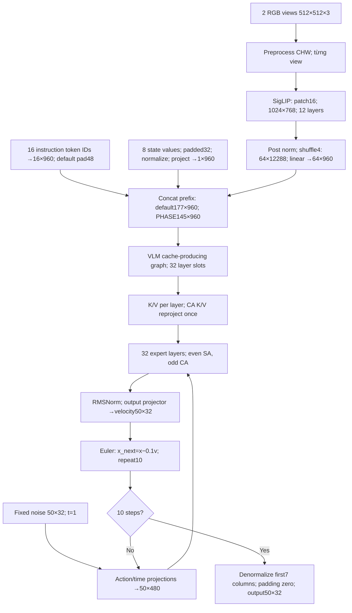

# Kiến trúc từ paper, checkpoint và source

[Paper SmolVLA, mục 3.1](https://arxiv.org/html/2506.01844v1#S3.SS1) mô tả VLM nhỏ kết hợp action expert flow matching, giảm visual token, cắt tầng và attention xen kẽ. Không lấy cấu hình minh họa paper thay cho checkpoint này. Metadata gốc: [smolvla-metadata.json](../smolvla-followup-20261104/smolvla-metadata.json); source: [smolvla.cpp](../../src/models/smolvla.cpp).

Shapes trong sơ đồ dùng quy ước token×feature để dễ đọc; GGML tensor thường ghi feature trước, ví dụ `[960,64]`. Không phải layout bộ nhớ CHW đều giống quy ước hiển thị này.

| Module | Input → output | Hàm và dòng hiện tại |
|---|---|---|
| Vision | RGB→CHW float; patch grid32×32; hidden768,12 heads,FFN3072; output1024×768 mỗi view | `predict_impl` 1355–1398; `build_siglip_layer` 311–335 |
| Connector | Shuffle grid32×32→8×8; feature768×16=12288; linear12288→960;64 token/view | `predict_impl` 1371–1374; loader945–986 |
| Language/state | IDs→embedding960; state32 normalized, linear→1 token | 1451–1476; `build_graph`1229–1233 |
| VLM | Prefix177 tokens default hoặc145 PHASE; hidden960,15Q/5KV heads,head_dim64,FFN2560; K/V GGML `[64,5,prefix]` mỗi layer | `build_vlm_layer`689–698; `build_graph`1238–1245 |
| Cross K/V | Cache reshape320×prefix; projected cache dùng lại mọi step | `expert_cross_kv`718–724;1257–1267 |
| Expert | Actions50×32 + time→50×480;32 layers,FFN1280; velocity50×32 | `build_expert_self_attn_layer`701; `build_expert_cross_attn_layer`727;1270–1288 |
| Solver/output | 10 Euler steps,dt=−0.1;50 actions,7 cột thực,25 cột padding |1270–1288;1564–1574 |

`expert_self_attn`233–234 chọn SA tại index chẵn khi interval=2; SA ghép prefix K/V với action K/V và causal mask. CA chỉ đọc prefix K/V đã reproject, không tương tác action-action trong layer đó. VLM có32 slot dựng graph; backend chỉ thực thi dependency reachable từ output/cache, không mặc định mọi op cuối mỗi layer đều chạy nếu không dùng.

Vision/VLM chạy một lần mỗi prediction; action expert lặp10 lần. Tăng số step tăng phần expert/solver, không nhân toàn bộ vision lên10. Gần tuyến tính chỉ là giả thuyết chi phí khi các yếu tố khác giữ nguyên; không suy ra chính xác latency từ số step.

Không có vòng decode từng token ngôn ngữ. “Prefill” ở đây là tính prefix/cache. Action chunk50 vị trí được xử lý trong mỗi bước denoise, không phải sinh từng action token bằng autoregressive text decode.
